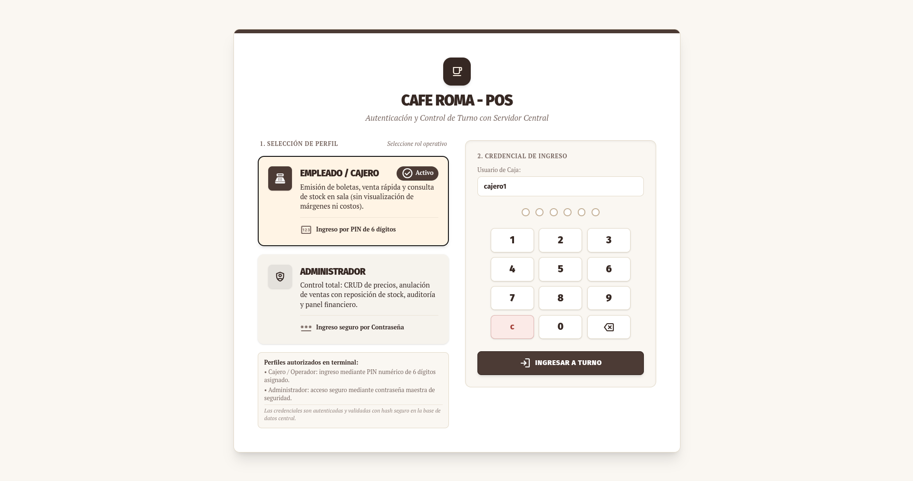
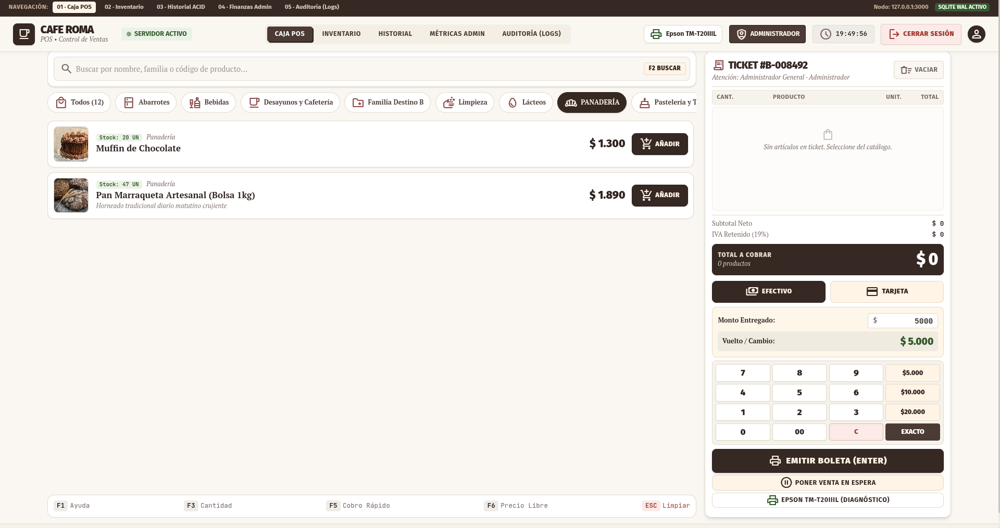
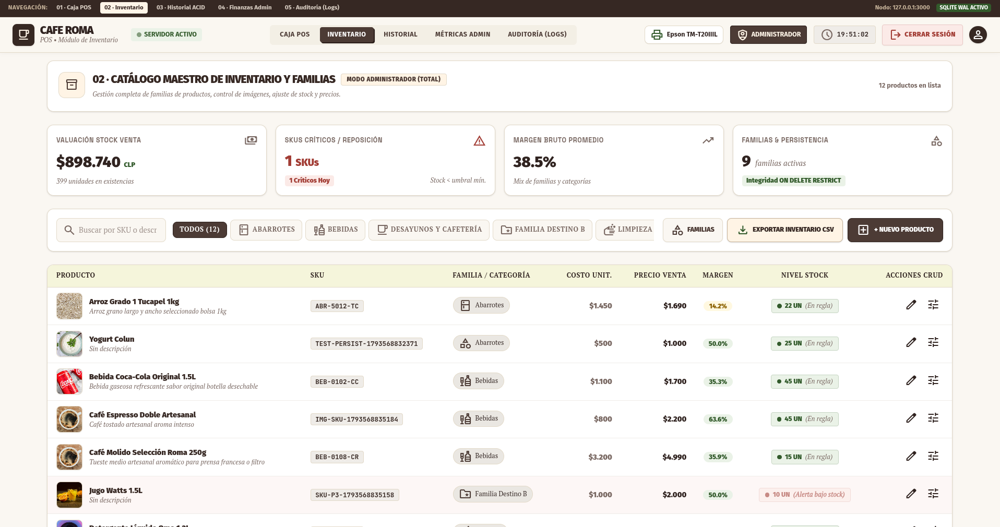
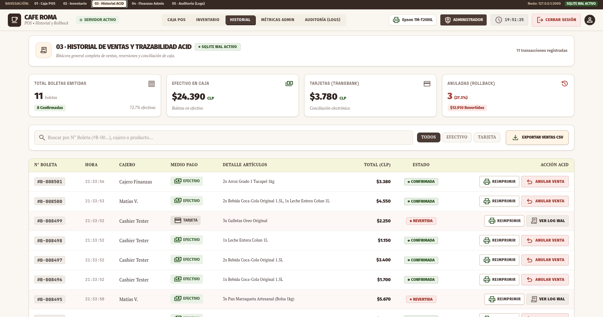
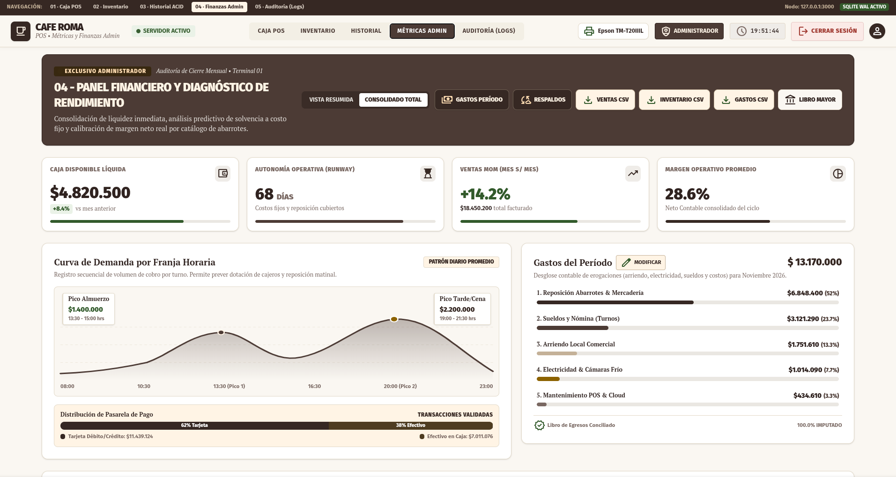
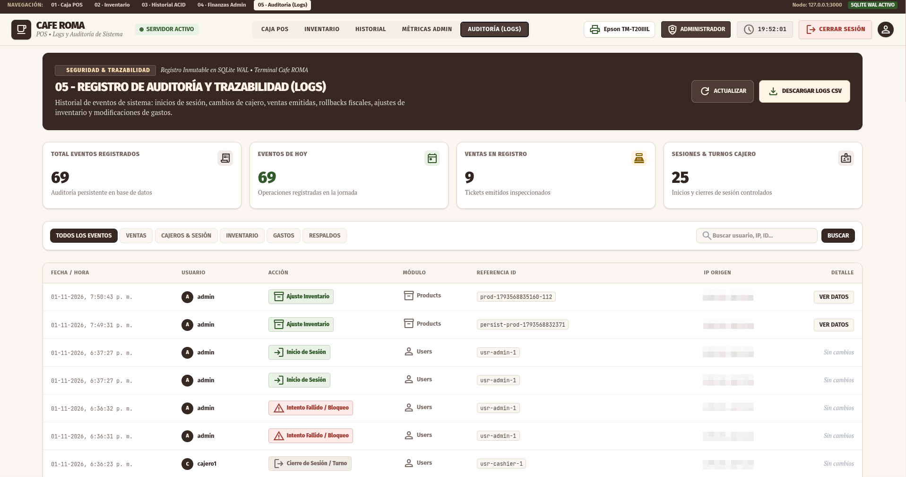

<h1 align="center">☕ Café ROMA – Sistema POS</h1>

  Sistema de punto de venta para cafetería con inventario, auditoría y panel financiero.

  
  
  
  

> Proyecto personal de desarrollo full-stack. El código fuente es privado; este repositorio presenta el proyecto, sus funcionalidades y sus capturas.

## Descripción

Hace poco terminé un sistema de punto de venta (POS) para un negocio familiar que abrirá próximamente. Es una aplicación web que corre en local con Node.js, pensada para resolver necesidades reales de un negocio pequeño y, de paso, poner a prueba lo que he aprendido en la carrera de Ingeniería Civil Informática.

Incluye caja para registrar ventas e imprimir tickets en impresora térmica, inicio de sesión con roles de administrador y cajero, control de inventario, cálculo de ganancia bruta, registro de gastos con su módulo de finanzas, estadísticas de ventas y conexión con base de datos. Los respaldos se guardan en Google Drive y los reportes se exportan a Excel/CSV.

## Capturas de pantalla

| Pantalla | Descripción |
|---|---|
|  | Inicio de sesión |
|  | Punto de venta y carrito |
|  | Gestión de productos y stock |
|  | Historial de ventas y reversas |
|  | Panel financiero y diagnóstico |
|  | Bitácora de acciones |

## Funcionalidades

- **Ventas:** carrito, cobro con distintos medios de pago y emisión de boletas. Cada venta es atómica: si algo falla, no queda registro a medias.
- **Reversas:** anulación de ventas con motivo obligatorio, restauración automática del stock y protección contra doble reversa.
- **Inventario:** productos organizados por familias, con costo unitario, costo de reposición y niveles de stock.
- **Finanzas:** ingresos, costos, gastos operativos, margen neto y ROI, con exportación a CSV.
- **Auditoría:** registro de acciones de los usuarios, descargable en CSV.
- **Roles:** perfiles de administrador y cajero, con ocultamiento de costos y ventas mensuales para el cajero.
- **Impresión:** boletas en impresora térmica Epson TM-T20IIIL mediante un agente local.
- **Respaldos:** copias automáticas de la base de datos, sincronizables con Google Drive.

## Decisiones técnicas

- **Integridad de las ventas:** cada cobro se procesa en una sola transacción y es idempotente, así que un reintento no duplica el cobro.
- **Seguridad:** contraseñas con scrypt y sal única, sesiones con token de 256 bits guardado como hash SHA-256, bloqueo de cuenta tras intentos fallidos, protección CSRF y encabezados con Helmet.
- **Control de acceso:** las reglas de rol se validan en el servidor, no solo en la interfaz.
- **Base de datos:** SQLite en modo WAL con migraciones versionadas. Antes de cada migración se genera un respaldo automático.
- **Pruebas:** suites con Vitest y Supertest que cubren autenticación y control de acceso por rol, ventas y reversas, auditoría, CRUD de familias, cálculos financieros, comunicación con la impresora y persistencia tras reiniciar.
- **Uso de IA:** la usé como apoyo para la integración con Google Sheets y para automatizar tareas repetitivas. Revisé cada parte para poder explicarla y mantenerla.

## Tecnologías

| Capa | Tecnologías |
|---|---|
| Frontend | React 19, Vite, Tailwind CSS 4, Motion, Lucide |
| Backend | Node.js, Express, Helmet, cookie-parser |
| Base de datos | SQLite (`node:sqlite`, modo WAL) |
| Impresión | escpos, escpos-usb |
| Pruebas | Vitest, Supertest |
| Lenguaje | TypeScript |

## Feedback

Si tienes experiencia en sistemas POS, impresión térmica o integración con Google Sheets, agradezco cualquier comentario.

## Autor

Desarrollado por **Rodolfo Alberto Palma Torres**.
